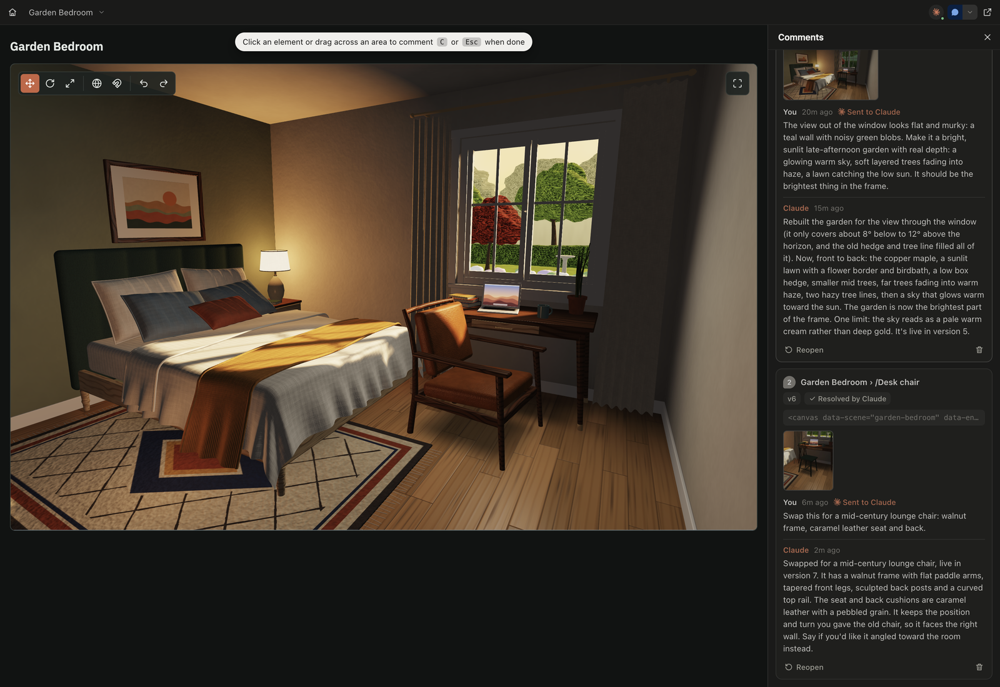

# Spatial Artifacts

3D design for Claude Code, the way Artifacts handles UI. Ask Claude for a 3D mockup (a room, a product, a layout), then
orbit it, move things with gizmos and leave comments on objects. Claude reads each comment, changes the scene and
replies.



Rotate a chair, comment on it, and Claude rebuilds it. Every model in the scene was generated from scratch in the
session; see [examples/bedroom](examples/bedroom).

- **Edit scenes directly.** Select, move, rotate and scale with gizmos, with snapping and undo. Your edits are kept.
- **Comment on 3D objects.** Pins stay on the object as the camera moves. Drag across an area to comment on everything
  in it, and attach reference images to show what you mean.
- **2D pages too.** Dashboards, reports and prototypes, with the same comments.
- **Local only.** Everything is served from `localhost`; nothing is uploaded.

Community project, not affiliated with or endorsed by Anthropic. It began as a local take on Claude Code's Artifact
tools and adds what the hosted viewer can't do: 3D. Scenes render with the [PlayCanvas](https://playcanvas.com) engine.

## Install

Claude Code:

```bash
/plugin marketplace add kpal81xd/spatial-artifacts
/plugin install spatial-artifacts@kpal
/reload-plugins
```

Codex: clone this repository, open it in Codex, restart Codex, and install `spatial-artifacts` from the `kpal`
marketplace in the plugin picker.

Requires Node 22.18 or later.

## Try it

1. Ask Claude: _"Make a 3D scene of a desk with a lamp, a laptop and a chair."_ The scene opens in your browser.
2. Press **C**, click an object and write a comment, for example _"make the lamp shade wider"_.
3. Click **Send to Claude**. Claude updates the scene and replies in the thread.

Run `/spatial` to see everything you've made.

| Action                 | Control                     |
| ---------------------- | --------------------------- |
| Orbit / pan / zoom     | Drag / Shift+drag / scroll  |
| Fly                    | Hold right button + W A S D |
| Select                 | Click (Shift+click to add)  |
| Move / rotate / scale  | 1 / 2 / 3                   |
| Frame selection / undo | F / Ctrl+Z (⌘Z)             |
| Comment mode           | C                           |

Settings, Codex details, the security model and the page API are in the
[plugin README](plugins/spatial-artifacts/README.md).

## Development

```bash
bun install
bun run test
bun run dev   # Claude with this checkout's plugin, on its own daemon and a copy of your data
```

See [CONTRIBUTING.md](CONTRIBUTING.md) for lint, typecheck and the dev setup.

## License

[MIT](LICENSE). A community project, not affiliated with or endorsed by Anthropic.
